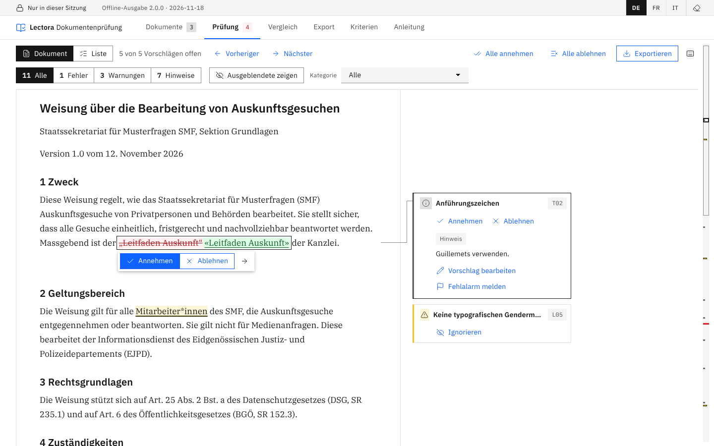

# Lectora

Lectora prüft Verwaltungsdokumente der Bundesverwaltung auf Deutsch, Französisch und Italienisch. Du lädst eine Weisung, ein Konzept, eine Aktennotiz oder eine Präsentation (Word, PDF, PowerPoint). Lectora prüft sie im Browser gegen einen Kriterienkatalog, zeigt die Befunde im Text und vergleicht Sprachfassungen. Korrekturen nimmst du an oder lehnst sie ab wie in Word. Am Schluss exportierst du ein Word-Dokument mit Änderungsverfolgung, eine bereinigte Fassung oder einen Prüfbericht.

Die Oberfläche gibt es auf Deutsch, Französisch und Italienisch.

- **Produktdokumentation:** [sem-sgg.github.io/lectora/dokumentation.html](https://sem-sgg.github.io/lectora/dokumentation.html) (Deutsch, Französisch, Italienisch)
- **Lectora pflegen, ohne Kommandozeile** (Pull Requests von Dependabot, monatlicher Abgleich der Erlasse, Veröffentlichung): [docs/pflege.md](docs/pflege.md)

## Zwei Ausgaben

Lectora entsteht aus einer Quelle in zwei Ausgaben.

| | Offline-Ausgabe | Artefakt-Ausgabe |
| --- | --- | --- |
| Form | eine HTML-Datei (`Lectora.html`) | Seite auf claude.ai (Artefakt) |
| Öffnen | Doppelklick, im Browser; oder als Webseite auf GitHub Pages | in Claude, mit Anmeldung |
| Regelprüfung (lokal, über 50 Kriterien) | ja | ja |
| Formaler Sprachvergleich, Synopse dreier Fassungen | ja | ja |
| Export: Word mit Änderungsverfolgung, bereinigte Fassung, Prüfbericht, PDF und PowerPoint mit Kommentaren | ja | ja |
| Prüfprofile, Standardprofile der Sektion, Rückmeldung zu Fehlalarmen | ja | ja |
| Dokumente mit Vermerk INTERN, VERTRAULICH oder GEHEIM | als gespeicherte Datei ja (lokal); als Webseite nein | nein: nicht geladen, nicht geprüft |
| KI-Prüfung, Bedeutungsvergleich, Formulierungsvorschläge, Rückübersetzung, Pflichtenmatrix | nein | ja, je Lauf auf ausdrücklichen Klick |
| Verbindungen | eine: beim Start die Versionsnummer auf GitHub Pages | vier Dateien von Programmbibliotheken von cdnjs (mit Integritätsprüfung); Text an Claude nur bei KI-Funktionen |
| Konto | keines | Claude-Konto |

Die KI-Funktionen laufen nur in der Artefakt-Ausgabe. Wie du ein eigenes Artefakt erstellst, steht in [docs/artefakt-erstellen.md](docs/artefakt-erstellen.md).

## Herunterladen und öffnen

- **Datei:** Lade [`Lectora.html`](https://github.com/SEM-SGG/lectora/releases/latest/download/Lectora.html) direkt herunter (oder von der [Seite der neusten Ausgabe](https://github.com/SEM-SGG/lectora/releases/latest)). Öffne die Datei mit einem Doppelklick. Sie läuft ohne Installation und ohne Internet. Die Prüfsummen stehen in `SHA256SUMS.txt` daneben.
- **Webseite:** Öffne [sem-sgg.github.io/lectora](https://sem-sgg.github.io/lectora/). Dort liegt immer die neuste Ausgabe. Es ist dieselbe Datei; deine Dokumente bleiben auch dort im Browser. Die Webseite ist für unklassifizierte Dokumente und zum Ausprobieren gedacht. Mit «Als Datei speichern» lädst du die Datei `Lectora.html` direkt herunter.

**Merkregel: Klassifizierte Dokumente prüft nur die gespeicherte Datei `Lectora.html`. Webseite und Artefakt: nur unklassifizierte Dokumente.** Dokumente mit dem Vermerk INTERN, VERTRAULICH oder GEHEIM prüfst du mit der heruntergeladenen Datei `Lectora.html`. Erkennt Lectora auf der Webseite oder im Artefakt auf claude.ai einen dieser Vermerke, lädt und prüft es das Dokument dort nicht und verweist auf die Datei. An Claude sendet Lectora solche Dokumente nie. Die Erkennung ist eine Näherung. Die Grundlage ist die [Datenregel der SGG](#datenregel); Einzelheiten stehen in [docs/datenschutz.md](docs/datenschutz.md#github-pages).

Gibt es eine neuere Version, zeigt Lectora oben einen Hinweis mit dem Knopf «Neue Version herunterladen». Ein Klick lädt die neue `Lectora.html` direkt herunter.

**Entscheide exportieren:** Lectora speichert nichts. Hast du Vorschläge angenommen oder abgelehnt und noch nicht exportiert, fragt der Browser nach, bevor du den Tab schliesst oder neu lädst. Verwirft der Browser einen Tab im Hintergrund (in Edge «schlafende Tabs»), fragt er nicht. Exportiere deshalb vor einer Pause.

## Produktdokumentation

Die Produktdokumentation erklärt auf Deutsch, Französisch und Italienisch, was Lectora tut, wie der Arbeitsablauf aussieht, welche Ausgaben es gibt und wie Lectora mit deinen Dokumenten umgeht: [sem-sgg.github.io/lectora/dokumentation.html](https://sem-sgg.github.io/lectora/dokumentation.html). Bei jeder Veröffentlichung übernimmt die Webseite die aktuelle Fassung aus [`docs/lectora-dokumentation.html`](docs/lectora-dokumentation.html). Auch die Anleitung in Lectora verlinkt sie im Abschnitt «Hilfe und Rückmeldung».

## Datenregel

Für alle Repositories der Organisation SEM-SGG gilt diese Regel:

> **Datenregel der SGG**
>
> 1. **Lokal ist jede Klassifizierungsstufe erlaubt.** Was ein Werkzeug ausschliesslich auf deinem Gerät oder lokal im Browser verarbeitet und nicht ins Internet sendet, darfst du unabhängig von der Klassifizierungsstufe bearbeiten.
> 2. **INTERN oder höher geht nicht ins Internet.** Dokumente und Inhalte mit dem Vermerk INTERN, VERTRAULICH oder GEHEIM lädst du nicht ins Internet und teilst oder verarbeitest sie nicht über externe Cloud-Dienste. Dazu gehören KI-Dienste (zum Beispiel Claude und ChatGPT), GitHub (Repositories, Issues, Pull Requests) und Online-Speicher ausserhalb der Arbeitsumgebung des Bundes.
> 3. **Personendaten.** Unabhängig von der Klassifizierung gehören keine besonders schützenswerten Personendaten und keine Falldaten zu Personen aus Verfahren ins Internet oder in externe Cloud-Dienste.
> 4. **Arbeitsumgebung des Bundes.** Für die vom Bund bereitgestellten Dienste (zum Beispiel Teams, Outlook, SharePoint) gelten die Weisungen des SEM.
>
> Als klassifiziert gilt, was einen Klassifizierungsvermerk trägt. Die Regel ergänzt die Weisungen des SEM und ersetzt sie nicht.

Was daraus für Lectora folgt:

| Ausgabe | Dokumente mit Vermerk INTERN, VERTRAULICH oder GEHEIM |
| --- | --- |
| Gespeicherte Datei `Lectora.html` | prüft sie lokal, wie alle Dokumente (Punkt 1) |
| Webseite auf GitHub Pages | lädt und prüft sie nicht und verweist auf die Datei `Lectora.html` (Punkt 2: GitHub liefert den Programmcode aus) |
| Artefakt-Ausgabe auf claude.ai | lädt und prüft sie nicht und verweist auf die Datei `Lectora.html` (Punkt 2: claude.ai und cdnjs liefern den Programmcode aus); an Claude gehen sie nie |

Die Sperre lässt sich nicht übergehen. Die Sperre der KI-Funktionen bleibt als zweite Sicherung bestehen, etwa für einen Vermerk, den Lectora erst in einer später geladenen Fassung erkennt. Der Dialog vor dem Senden an Claude nennt zusätzlich Punkt 3 (Personendaten).

Lectora erkennt den Vermerk nach Muster; die Erkennung ist eine Näherung und sperrt im Zweifel eher zu viel. Personendaten erkennt Lectora nicht. Was du auf der Webseite oder im Artefakt prüfst und an Claude sendest, verantwortest du.

## Datenschutz in Kürze

- **Deine Dokumente bleiben auf deinem Computer.** Der Browser liest die Dateien direkt. Dokumente, Befunde und Einstellungen liegen nur im Arbeitsspeicher des Tabs. Lectora speichert nichts: kein Server, keine Datenbank, kein Browser-Speicher, keine Cookies. Schliesst du den Tab, ist alles weg.
- **Eine Anfrage beim Start (Offline-Ausgabe).** Die Datei liest auf GitHub Pages die Nummer der neusten Version (`sem-sgg.github.io/lectora/version.json`). Die Anfrage enthält keine Dokumentdaten und keine Kennung. GitHub sieht dabei wie bei jedem Webzugriff die IP-Adresse deines Computers, den Browser, seine Sprache und die Uhrzeit. Eine Sicherheitsrichtlinie in der Datei erlaubt nur diese eine Adresse. Wer auch diese Anfrage nicht will, baut eine Ausgabe ohne Versionsabfrage (siehe [docs/datenschutz.md](docs/datenschutz.md)).
- **Webseite auf GitHub Pages:** GitHub liefert den Programmcode bei jedem Aufruf neu aus; eine gespeicherte `Lectora.html` ändert sich dagegen nicht unbemerkt. Deshalb ist die Webseite für unklassifizierte Dokumente gedacht. Dokumente mit dem Vermerk INTERN, VERTRAULICH oder GEHEIM prüft Lectora dort nicht. Verwende dafür die gespeicherte Datei `Lectora.html`: Sie prüft alle Dokumente ohne Einschränkung lokal. Die Webseite erkennt den Vermerk nach Muster; die Erkennung ist eine Näherung.
- **Artefakt-Ausgabe:** Sie lädt vier Dateien von Programmbibliotheken von cdnjs, jede mit Integritätsprüfung. Text an Claude geht nur, wenn du eine KI-Funktion startest. Lectora sagt vorher, was gesendet wird, und fragt nach; nur bei Formulierungsvorschlägen (einzelne Sätze) kannst du die Rückfrage für die Sitzung abschalten. Dokumente mit dem Vermerk INTERN, VERTRAULICH oder GEHEIM lädt und prüft Lectora im Artefakt nicht, weil auch hier eine fremde Infrastruktur den Programmcode ausliefert; an Claude sendet es sie nie. Die Erkennung des Vermerks ist eine Näherung. An Claude gehen nach der [Datenregel](#datenregel) nur unklassifizierte Dokumente ohne besonders schützenswerte Personendaten und ohne Falldaten zu Personen aus Verfahren. Welche weiteren Bedingungen für den gesendeten Text gelten, hängt vom Claude-Konto ab (siehe [docs/datenschutz.md](docs/datenschutz.md)).

Ausführlich: [docs/datenschutz.md](docs/datenschutz.md).

## Browser

Getestet mit Chromium (der Engine von Google Chrome und Microsoft Edge) in den automatischen Tests, bei 1440, 1056, 840 und 375 Pixel Breite. Microsoft Edge selbst, Firefox und Safari sind nicht automatisch getestet.

## Probleme melden

- **Fehler:** Lege im Repository ein [Issue](https://github.com/SEM-SGG/lectora/issues/new/choose) mit der Vorlage «Fehler» an.
- **Eine Regel meldet einen Fehlalarm:** Vorlage «Regel meldet Fehlalarm».
- **Ohne GitHub-Konto:** Schreibe an die Funktionsadresse der Sektion, `sektion-grenze@sem.admin.ch`.
- **Wichtig:** Dieses Repository ist öffentlich. Schreibe nie Text aus einem Dokument in ein Issue (eine Meldung auf GitHub), auch nicht auszugsweise. Auch Rückmeldedateien mit Textauszügen gehören nie in ein Issue; per Mail sendest du sie nur innerhalb der Arbeitsumgebung des Bundes (siehe [Datenregel](#datenregel) und [docs/rueckmeldungen.md](docs/rueckmeldungen.md)).
- Sicherheitslücken meldest du nicht öffentlich, sondern wie in [SECURITY.md](SECURITY.md) beschrieben.
- Beiträge von aussen (Pull Requests) nehmen wir an, sobald die Lizenz geklärt ist (siehe [CONTRIBUTING.md](CONTRIBUTING.md)).

## Lizenz

Die Lizenz für Lectora wird geklärt (Art. 9 EMBAG). Bis dahin steht Lectora unter keiner Lizenz. Die eingebetteten Komponenten Dritter (JSZip, PDF.js, pdf-lib, Schriften IBM Plex, Icons Lucide) stehen unter ihren eigenen Lizenzen: [THIRD-PARTY-NOTICES.md](THIRD-PARTY-NOTICES.md).

## Für Entwicklerinnen und Entwickler

- [docs/entwicklung.md](docs/entwicklung.md): einrichten, bauen, testen, Aufbau der Quellen
- [docs/architektur.md](docs/architektur.md): Module, Zustand, Ausgaben, Sicherheitsrichtlinien, KI-Schnittstelle
- [docs/kriterium-ergaenzen.md](docs/kriterium-ergaenzen.md): eine lokale Regel hinzufügen, Schritt für Schritt
- [docs/release.md](docs/release.md): neue Version veröffentlichen, zurückrollen
- [docs/pflege.md](docs/pflege.md): Pull Requests von Dependabot, zeitgesteuerter Lauf «erlasse», Übergabe
- [docs/repo-einstellungen.md](docs/repo-einstellungen.md): Einstellungen bei GitHub, auf die Workflows und Dokumente angewiesen sind
- [docs/erlasstabelle.md](docs/erlasstabelle.md), [docs/profile.md](docs/profile.md), [docs/rueckmeldungen.md](docs/rueckmeldungen.md)
- [AGENTS.md](AGENTS.md): Regeln für KI-Assistenten, die am Code arbeiten
- [CHANGELOG.md](CHANGELOG.md): Änderungen je Version
