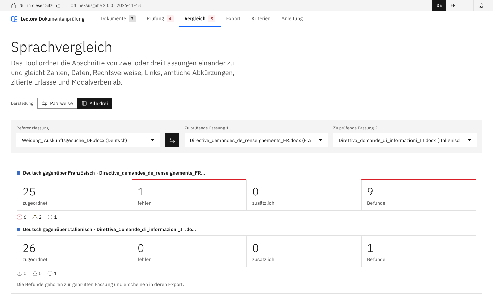

# Lectora

Lectora prüft Verwaltungsdokumente der Bundesverwaltung auf Deutsch, Französisch und Italienisch. Du lädst eine Weisung, ein Konzept, eine Aktennotiz oder eine Präsentation (Word, PDF, PowerPoint). Lectora prüft sie im Browser gegen einen Kriterienkatalog, zeigt die Befunde im Text und vergleicht Sprachfassungen. Korrekturen nimmst du an oder lehnst sie ab wie in Word. Am Schluss exportierst du ein Word-Dokument mit Änderungsverfolgung, eine bereinigte Fassung oder einen Prüfbericht.

Die Oberfläche gibt es auf Deutsch, Französisch und Italienisch.

## Zwei Ausgaben

Lectora entsteht aus einer Quelle in zwei Ausgaben.

| | Offline-Ausgabe | Artefakt-Ausgabe |
| --- | --- | --- |
| Form | eine HTML-Datei (`Lectora.html`) | Seite auf claude.ai (Artefakt) |
| Öffnen | Doppelklick, im Browser; oder als Webseite auf GitHub Pages | in Claude, mit Anmeldung |
| Regelprüfung (lokal, über 50 Kriterien) | ja | ja |
| Formaler Sprachvergleich, Synopse dreier Fassungen | ja | ja |
| Export: Word mit Änderungsverfolgung, bereinigte Fassung, Prüfbericht, PDF und PowerPoint mit Kommentaren | ja | ja |
| Prüfprofile, Standardprofile der Sektion, Rückmeldung zu Fehlalarmen | ja | ja |
| KI-Prüfung, Bedeutungsvergleich, Formulierungsvorschläge, Rückübersetzung, Pflichtenmatrix | nein | ja, je Lauf auf ausdrücklichen Klick |
| Verbindungen | eine: beim Start die Versionsnummer auf GitHub Pages | vier Dateien von Programmbibliotheken von cdnjs (mit Integritätsprüfung); Text an Claude nur bei KI-Funktionen |
| Konto | keines | Claude-Konto |

Die KI-Funktionen laufen nur in der Artefakt-Ausgabe. Wie du ein eigenes Artefakt erstellst, steht in [docs/artefakt-erstellen.md](docs/artefakt-erstellen.md).

## Herunterladen und öffnen

- **Datei:** Lade [`Lectora.html`](https://github.com/SEM-SGG/lectora/releases/latest/download/Lectora.html) direkt herunter (oder von der [Seite der neusten Ausgabe](https://github.com/SEM-SGG/lectora/releases/latest)). Öffne die Datei mit einem Doppelklick. Sie läuft ohne Installation und ohne Internet. Die Prüfsummen stehen in `SHA256SUMS.txt` daneben.
- **Webseite:** Öffne [sem-sgg.github.io/lectora](https://sem-sgg.github.io/lectora/). Dort liegt immer die neuste Ausgabe. Es ist dieselbe Datei; deine Dokumente bleiben auch dort im Browser. Mit «Als Datei speichern» holst du dir eine eigene Kopie.

Gibt es eine neuere Version, zeigt Lectora oben einen Hinweis mit «Neue Version herunterladen».

## Datenschutz in Kürze

- **Deine Dokumente bleiben auf deinem Computer.** Der Browser liest die Dateien direkt. Dokumente, Befunde und Einstellungen liegen nur im Arbeitsspeicher des Tabs. Lectora speichert nichts: kein Server, keine Datenbank, kein Browser-Speicher, keine Cookies. Schliesst du den Tab, ist alles weg.
- **Eine Anfrage beim Start (Offline-Ausgabe).** Die Datei liest auf GitHub Pages die Nummer der neusten Version (`sem-sgg.github.io/lectora/version.json`). Die Anfrage enthält keine Dokumentdaten und keine Kennung. GitHub sieht dabei wie bei jedem Webzugriff die IP-Adresse deines Computers, den Browser, seine Sprache und die Uhrzeit. Eine Sicherheitsrichtlinie in der Datei erlaubt nur diese eine Adresse. Wer auch diese Anfrage nicht will, baut eine Ausgabe ohne Versionsabfrage (siehe [docs/datenschutz.md](docs/datenschutz.md)).
- **Artefakt-Ausgabe:** Sie lädt vier Dateien von Programmbibliotheken von cdnjs, jede mit Integritätsprüfung. Text an Claude geht nur, wenn du eine KI-Funktion startest. Lectora sagt vorher, was gesendet wird, und fragt nach; nur bei Formulierungsvorschlägen (einzelne Sätze) kannst du die Rückfrage für die Sitzung abschalten. Dokumente mit dem Vermerk VERTRAULICH oder GEHEIM sendet Lectora nie an Claude; die Erkennung des Vermerks ist eine Näherung. Welche Bedingungen für den gesendeten Text gelten, hängt vom Claude-Konto ab: Klärt das vor dem Einsatz mit echten Dokumenten (siehe [docs/datenschutz.md](docs/datenschutz.md)).

Ausführlich: [docs/datenschutz.md](docs/datenschutz.md).

## Browser

Getestet mit Chromium (der Engine von Google Chrome und Microsoft Edge) in den automatischen Tests, bei 1440, 1056, 840 und 375 Pixel Breite. Microsoft Edge selbst, Firefox und Safari sind nicht automatisch getestet.

## Probleme melden

- **Fehler:** Lege im Repository ein [Issue](https://github.com/SEM-SGG/lectora/issues/new/choose) mit der Vorlage «Fehler» an.
- **Eine Regel meldet einen Fehlalarm:** Vorlage «Regel meldet Fehlalarm».
- **Wichtig:** Dieses Repository ist öffentlich. Schreibe nie Text aus einem Dokument in ein Issue, auch nicht auszugsweise. Rückmeldedateien mit Textauszügen gehören in das interne Repository der Sektion (siehe [docs/rueckmeldungen.md](docs/rueckmeldungen.md)).
- Sicherheitslücken meldest du nicht öffentlich, sondern wie in [SECURITY.md](SECURITY.md) beschrieben.
- Beiträge von aussen (Pull Requests) nehmen wir an, sobald die Lizenz geklärt ist (siehe [CONTRIBUTING.md](CONTRIBUTING.md)).

## Lizenz

Die Lizenz für Lectora wird geklärt (Art. 9 EMBAG). Bis dahin steht Lectora unter keiner Lizenz. Die eingebetteten Komponenten Dritter (JSZip, PDF.js, pdf-lib, Schriften IBM Plex, Icons Lucide) stehen unter ihren eigenen Lizenzen: [THIRD-PARTY-NOTICES.md](THIRD-PARTY-NOTICES.md).

## Für Entwicklerinnen und Entwickler

- [docs/entwicklung.md](docs/entwicklung.md): einrichten, bauen, testen, Aufbau der Quellen
- [docs/architektur.md](docs/architektur.md): Module, Zustand, Ausgaben, Sicherheitsrichtlinien, KI-Schnittstelle
- [docs/kriterium-ergaenzen.md](docs/kriterium-ergaenzen.md): eine lokale Regel hinzufügen, Schritt für Schritt
- [docs/release.md](docs/release.md): neue Version veröffentlichen, zurückrollen
- [docs/repo-einstellungen.md](docs/repo-einstellungen.md): Einstellungen bei GitHub, auf die Workflows und Dokumente angewiesen sind
- [docs/erlasstabelle.md](docs/erlasstabelle.md), [docs/profile.md](docs/profile.md), [docs/rueckmeldungen.md](docs/rueckmeldungen.md)
- [AGENTS.md](AGENTS.md): Regeln für KI-Assistenten, die am Code arbeiten
- [CHANGELOG.md](CHANGELOG.md): Änderungen je Version
